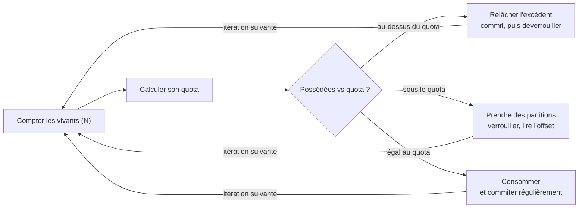

# Mojay — note de conception

Version versionnée avec le code de la [note de conception en ligne](https://claude.ai/artifact/674k8FuSABpT9t2fr7fA1w).
Dernière mise à jour : 20 novembre 2026.

## Contexte et objectifs

Mojay est une bibliothèque Rust qui offre topics, partitions, offsets et consumer groups dans un simple dossier local, sans serveur ni Docker. C'est l'équivalent de SQLite pour Kafka : on ouvre un dossier, on produit, on consomme.

**Objectifs de la V1**

- Embarquable : une crate Rust, puis une ABI C pour des bindings Python, Node, etc.
- Zéro serveur : toute la coordination passe par le système de fichiers (verrous `flock`).
- Multi-processus : plusieurs processus d'une même machine partagent le même dossier.
- Durabilité configurable et récupération automatique après crash.

**Non-objectifs de la V1**

- Cluster, réplication, accès depuis plusieurs machines.
- Compatibilité avec le protocole réseau Kafka (possible plus tard, en couche au-dessus de la lib).
- Transactions et exactly-once.
- Compaction par clé, compression.
- Systèmes de fichiers réseau (NFS, SMB), et Windows : la V1 cible macOS et Linux.

## Concepts

Mojay reprend le vocabulaire de Kafka sans concept nouveau. Un consumer seul, un consommateur indépendant sans groupe, est l'unique membre d'un groupe qui porte son nom. Offsets et répartition passent ainsi par un seul chemin de code.

| Concept | Définition dans Mojay |
| --- | --- |
| Dossier de données | L'équivalent du fichier SQLite : tout l'état vit dedans, rien ailleurs. |
| Topic | Un nom et un nombre de partitions fixé à la création. Un seul writer à la fois. |
| Partition | Un log append-only ordonné. Unité d'ordre et unité de répartition dans un groupe. |
| Offset | Un `u64` par partition, qui commence à 0 et ne fait que croître. |
| Message | Clé optionnelle, valeur, headers, timestamp en millisecondes. |
| Consumer | Un processus qui lit un ou plusieurs topics. Il appartient toujours à un groupe, éventuellement seul dedans. |
| Consumer group | Des consumers qui se partagent les partitions, avec des offsets communs. Identifié par son nom. |
| Limite de lecture | Par partition, le premier offset pas encore lisible (`read_limit`). Les lecteurs ne lisent jamais au-delà. C'est l'équivalent du « high watermark » de Kafka. |

## Arborescence sur disque

Un topic est un dossier avec un sous-dossier par partition. Chaque consumer group a son propre espace, y compris le groupe d'un consumer seul, ce qui évite que deux processus écrivent le même fichier.

```
data/
  mojay.toml                       # version du format, options globales
  topics/<topic>/
    meta.toml                      # nombre de partitions, rétention, politique fsync
    writer.lock                    # flock exclusif = le writer du topic
    read_limits                    # limites de lecture, partagées en mmap
    p0/
      00000000000000000000.log     # segment, nommé par son premier offset
      00000000000000000000.idx     # index clairsemé offset -> position
    p1/ ...
  groups/<group>/                  # un consumer seul = un groupe à son nom
    members/<member_id>.lock       # verrouillé tant que le membre vit
    partitions/<topic>-<p>.lock    # verrouillé = partition possédée
    offsets/<topic>-<p>            # offset commité du groupe
```

Toutes les mises à jour de petits fichiers (`meta.toml`, offsets) sont atomiques : écriture d'un fichier temporaire, `fsync`, puis `rename`.

## Format du log

Chaque partition est une suite de segments append-only. Chaque enregistrement porte sa longueur et son CRC, ce qui permet de détecter une fin écrite à moitié après un crash.

**Segment** (`.log`) : un en-tête de 16 octets (magic `MOJAY\0`, version du format en `u16`, réservé), puis les enregistrements. On passe au segment suivant au-delà d'une taille maximale configurable.

**Enregistrement** (little-endian) :

| Champ | Type | Rôle |
| --- | --- | --- |
| `length` | `u32` | Taille de tout ce qui suit |
| `crc` | `u32` | CRC32C de tout ce qui suit |
| `offset` | `u64` | Offset absolu dans la partition |
| `timestamp` | `i64` | Millisecondes depuis l'epoch, fourni par le producteur |
| `attributes` | `u8` | Réservé (compression, flags futurs) |
| `key_len` + `key` | `i32` + octets | -1 = pas de clé |
| `value_len` + `value` | `i32` + octets | -1 = valeur nulle (tombstone) |
| `headers_count` | `u16` | Puis pour chaque header : `u16` + clé, `u32` + valeur |

**Index** (`.idx`) : des paires `(offset relatif u32, position u32)`, une tous les 4 Kio écrits. Pour lire un offset, on fait une recherche binaire dans l'index, puis un court parcours du segment. L'index se reconstruit entièrement depuis le `.log` : il n'a pas besoin d'être durable.

**Limites de lecture** (`read_limits`) : un fichier partagé en `mmap`, avec un `u64` aligné par partition. Le writer les publie avec une écriture atomique *Release* après chaque ajout. Les lecteurs les lisent avec une lecture atomique *Acquire*, sans appel système.

## Writer unique par topic

Un seul processus écrit dans un topic à la fois : celui qui tient le verrou `flock` exclusif sur `writer.lock`. Si ce processus crashe, l'OS libère le verrou, et le writer suivant répare la fin du log avant d'écrire.

1. **Prise du verrou** : `flock(LOCK_EX | LOCK_NB)`. En cas d'échec, on renvoie `Error::Busy`, ou on attend si l'appelant a fourni un délai.
2. **Récupération** : pour chaque partition, on relit le dernier segment depuis la dernière entrée d'index et on valide longueur et CRC. On tronque tout ce qui suit le dernier enregistrement valide, puis on recalcule l'index et la limite de lecture.
3. **Choix de la partition** : imposée par l'appelant, sinon hash de la clé (murmur2, comme Kafka), sinon round-robin quand il n'y a pas de clé.
4. **Ajout** : on écrit l'enregistrement, on met à jour l'index si besoin, on applique la politique de `fsync`, puis on publie la nouvelle limite de lecture.
5. **Rotation et rétention** : on ouvre un nouveau segment au-delà de la taille maximale. Le writer supprime les segments entiers les plus anciens qui dépassent la rétention (taille ou durée), et met à jour le premier offset disponible.

| Politique `fsync` | Quand | Survit à un crash du processus | Survit à une coupure de courant |
| --- | --- | --- | --- |
| `Always` | Avant chaque publication de la limite de lecture (par défaut) | Oui | Oui |
| `Interval(ms)` | Périodiquement, par un thread dédié | Oui | Sauf la dernière fenêtre |
| `Never` | Laissé à l'OS | Oui | Non garanti |

Un crash du processus ne perd que ce qui n'a pas encore été passé à `write`, car le cache de pages de l'OS survit. Seul `fsync` protège d'une coupure de courant ou d'un crash du noyau.

## Lecture des messages

Un topic accepte autant de consumers que voulu, sans aucun verrou en lecture. Les offsets sont toujours ceux d'un groupe, même pour un consumer seul.

- **Lecture** : les segments sont lus par `pread`, par gros blocs. Le `mmap` ne sert qu'au fichier `read_limits`. Aucune lecture ne dépasse la limite de lecture. Le log est append-only, donc lire pendant une écriture est sûr.
- **Écriture en cours** : juste après la limite de lecture, le writer peut être en train d'écrire. Un enregistrement illisible à cet endroit n'est donc pas une erreur ; avant la limite, c'en est une. Le lecteur ne répare jamais rien, et découvre seul les nouveaux segments.
- **Consumer seul** : un groupe à un membre, qui reçoit donc toutes les partitions. Si un second processus ouvre le même nom, il rejoint le groupe et les partitions se répartissent entre eux, comme dans Kafka.
- **Offsets** : `groups/<group>/offsets/<topic>-<p>` contient un `u64` et un CRC. Le commit est manuel, ou automatique à intervalle régulier.
- **Point de départ** : sans offset commité, on part du début (`Earliest`) ou de la fin (`Latest`).
- **Offset disparu** : si la rétention a supprimé l'offset demandé, la même politique s'applique, ou une erreur si l'appelant le préfère.
- **Attente de nouveaux messages** : en V1, un polling adaptatif de la limite de lecture en mémoire partagée, de 1 ms à 50 ms selon l'activité. Le coût est négligeable, car c'est une simple lecture mémoire.

`inotify` et `kqueue` ne signalent pas les écritures faites via `mmap`. Une notification événementielle demandera donc un canal séparé, à étudier après la V1.

## Consumer groups sans serveur

Un membre possède une partition tant qu'il tient le `flock` sur `partitions/<topic>-<p>.lock`. Le système de fichiers joue le rôle du coordinateur de Kafka : pas de serveur, pas de heartbeat, et un membre qui crashe perd ses verrous instantanément.

Chaque membre exécute cette boucle de son côté, toutes les 200 ms, et les vues des membres convergent en quelques itérations :



1. **Compter les vivants** : on tente un `flock` non bloquant sur chaque fichier de `members/`. S'il réussit, le membre est mort et on supprime son fichier. On obtient N membres vivants, triés par identifiant.
2. **Calculer son quota** : avec P partitions et un rang r parmi les vivants, quota = ⌊P / N⌋, plus 1 si r < P mod N. La somme des quotas vaut exactement P.
3. **Au-dessus du quota** : on commit l'offset, puis on relâche le verrou des partitions en trop.
4. **Sous le quota** : on tente un `flock` non bloquant sur les partitions libres, en partant d'un index dérivé de son rang pour limiter les collisions. Pour chaque partition obtenue, on lit l'offset commité du groupe.

**Passage de relais** : on commit avant de relâcher et on lit l'offset après avoir pris le verrou. Un rebalance normal ne produit donc aucun doublon. Seul un crash rejoue les messages depuis le dernier commit.

**Inscription sans course** : un nouveau membre crée son fichier sous un nom temporaire, le verrouille, puis le renomme dans `members/`. Le verrou suit l'inode, donc personne ne voit jamais ce fichier sans verrou et ne le prend pour celui d'un membre mort.

**Offsets du groupe** : `offsets/<topic>-<p>` n'est écrit que par le détenteur du verrou de la partition, par écriture atomique : fichier temporaire, puis `rename`.

## API publique Rust (esquisse)

L'API est synchrone en V1, avec trois points d'entrée : `Db`, `Producer` et `Consumer`. Une variante async pourra venir derrière une feature Cargo.

```rust
use mojay::{Db, Options, TopicConfig, Message, StartFrom};
use std::time::Duration;

let db = Db::open("./data", Options::default())?;
db.create_topic("orders", TopicConfig { partitions: 4, ..Default::default() })?;

// Producteur : prend le verrou writer du topic, Err(Busy) si déjà pris
let mut producer = db.producer("orders")?;
let (partition, offset) = producer.send(&Message::new(b"cmd-42", b"{...}"))?;
producer.flush()?;

// Consumer : rejoint le groupe "billing", seul dedans s'il est le seul processus
let mut consumer = db.consumer("billing", &["orders"], StartFrom::Earliest)?;
loop {
    for rec in consumer.poll(Duration::from_millis(500))? {
        println!("{} / {} : {:?}", rec.partition, rec.offset, rec.value);
    }
    consumer.commit()?;
}
```

- **Lecture brute** (disponible depuis l'étape 2) : `db.reader(topic)` renvoie un `TopicReader`, qui lit une partition à partir d'un offset, sans verrou et sans dépasser la limite de lecture. Les consumers de l'étape 3 s'appuient dessus.
- **Administration** : `list_topics`, `describe_topic` (partitions, premier offset, limite de lecture), `delete_topic`.
- **Rebalance** : des callbacks `on_assigned` et `on_revoked` préviennent l'application quand elle gagne ou perd une partition.
- **Erreurs** : `Busy`, `TopicExists`, `UnknownTopic`, `OffsetOutOfRange`, `Corrupt`, `Io`.

## Garanties et limites

Mojay garantit l'ordre par partition et une livraison at-least-once, sur une seule machine et un système de fichiers local.

**Garanties**

- Ordre strict à l'intérieur d'une partition, et deux messages de même clé vont toujours dans la même partition.
- Livraison at-least-once pour tous les consumers, seuls ou en groupe : un crash entre traitement et commit rejoue les messages concernés.
- Aucun message n'est visible avant d'être entièrement écrit, grâce à la limite de lecture.
- Durabilité selon la politique `fsync` choisie.

**Limites assumées**

- Système de fichiers local uniquement : `flock` n'est pas fiable sur NFS, SMB ou un dossier synchronisé dans le cloud. SQLite a la même restriction.
- Une seule machine.
- Un writer par topic, donc le débit d'écriture d'un topic est celui d'un seul processus.
- Nombre de partitions fixe en V1 : en ajouter changerait la partition associée à chaque clé.
- La latence d'un rebalance dépend de la période de la boucle (200 ms par défaut).

**Pièges connus**

- Utiliser `flock`, jamais les verrous POSIX `fcntl` : ceux-ci sont relâchés dès que le processus ferme *n'importe quel* descripteur sur le fichier.
- Un verrou `flock` est partagé avec tout processus enfant créé par `fork`, jusqu'à son `exec`. Fermer le fichier ne suffit donc pas à le libérer à coup sûr : on appelle `flock(LOCK_UN)` explicitement. Ce cas a été trouvé par un test instable, une fois sur huit.
- Sous Windows (hors V1), on ne peut pas supprimer un segment encore ouvert par un lecteur : la rétention devra y être différée.
- Les timestamps viennent de l'horloge du producteur, sans garantie de monotonie.

## Feuille de route

Le MVP se construit de bas en haut. Chaque étape est testable seule, en commençant par le log d'une partition.

1. ✅ Log d'une partition : format, segments, index, récupération. Tests de crash par troncature à chaque octet de la fin du log.
2. ✅ Topics, writer verrouillé et limites de lecture partagées. Tests multi-processus : second writer refusé, writer tué en pleine écriture, lecteur qui suit un writer d'un autre processus.
3. Consumer seul : lecture et offsets commités, avec des tests multi-processus.
4. Consumer groups à plusieurs membres.
5. Rétention par taille et par durée.
6. CLI `mojay` pour déboguer : `create-topic`, `produce`, `tail`, `describe`.
7. ABI C, puis un premier binding Python.

Après la V1 : index temporel (positionnement par timestamp), compression, compaction par clé, notification événementielle, couche protocole Kafka.

**Idées à étudier**

- **Voir les messages en texte, pour déboguer** : pouvoir vérifier à l'œil ce qui est stocké. Deux pistes :
    - un mode de stockage texte (une ligne lisible par enregistrement), activé par topic ;
    - garder le format binaire, et ajouter une commande `mojay dump` qui affiche un segment en texte (offsets, positions, CRC, clés, valeurs).

  La seconde piste semble préférable : un seul format à fiabiliser (récupération, CRC, valeurs binaires quelconques), et le dump fonctionne aussi sur les données de production. Elle s'intègre à la CLI de l'étape 6.

## Décisions

| Sujet | Décision |
| --- | --- |
| Politique `fsync` par défaut | `Always` |
| Taille de segment par défaut | 64 Mio |
| Hash de partitionnement | murmur2, compatible Kafka |
| Lecture des segments | `pread` ; `mmap` seulement pour `read_limits` |
| Écriture | Un writer par topic |
| Windows | Hors périmètre de la V1 |
