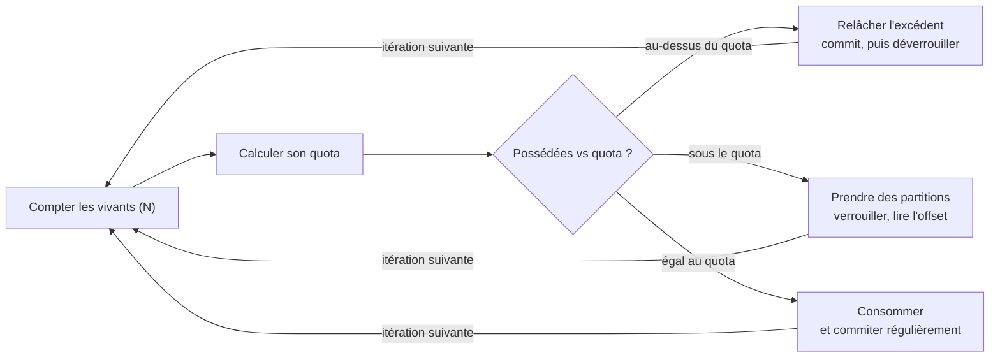

# Mojay — note de conception

Version versionnée avec le code de la [note de conception en ligne](https://claude.ai/artifact/674k8FuSABpT9t2fr7fA1w).
Dernière mise à jour : 20 novembre 2026.

## Contexte et objectifs

Mojay est une bibliothèque Rust qui offre topics, partitions, offsets et consumer groups dans un simple dossier local, sans serveur ni Docker. C'est l'équivalent de SQLite pour Kafka : on ouvre un dossier, on produit, on consomme.

**Objectifs de la V1**

- Embarquable : une crate Rust, puis une ABI C pour des bindings Python, Node, etc.
- Zéro serveur : toute la coordination passe par le système de fichiers (verrous `flock`).
- Multi-processus : plusieurs processus d'une même machine partagent le même dossier.
- Durabilité configurable et récupération automatique après crash.

**Non-objectifs de la V1**

- Cluster, réplication, accès depuis plusieurs machines.
- Compatibilité avec le protocole réseau Kafka (possible plus tard, en couche au-dessus de la lib).
- Transactions et exactly-once.
- Compaction par clé, compression.
- Systèmes de fichiers réseau (NFS, SMB), et Windows : la V1 cible macOS et Linux.

## Concepts

Mojay reprend le vocabulaire de Kafka sans concept nouveau. Un consumer seul, un consommateur indépendant sans groupe, est l'unique membre d'un groupe qui porte son nom. Offsets et répartition passent ainsi par un seul chemin de code.

| Concept | Définition dans Mojay |
| --- | --- |
| Dossier de données | L'équivalent du fichier SQLite : tout l'état vit dedans, rien ailleurs. |
| Topic | Un nom et un nombre de partitions fixé à la création. Autant de writers que voulu, à tour de rôle sur chaque partition. |
| Partition | Un log append-only ordonné. Unité d'ordre et unité de répartition dans un groupe. |
| Offset | Un `u64` par partition, qui commence à 0 et ne fait que croître. |
| Message | Clé optionnelle, valeur, headers, timestamp en millisecondes. |
| Consumer | Un processus qui lit un ou plusieurs topics. Il appartient toujours à un groupe, éventuellement seul dedans. |
| Consumer group | Des consumers qui se partagent les partitions, avec des offsets communs. Identifié par son nom. |
| Limite de lecture | Par partition, le premier offset pas encore lisible (`read_limit`). Les lecteurs ne lisent jamais au-delà. C'est l'équivalent du « high watermark » de Kafka. |

## Arborescence sur disque

Un topic est un dossier avec un sous-dossier par partition. Chaque consumer group a son propre espace, y compris le groupe d'un consumer seul, ce qui évite que deux processus écrivent le même fichier.

```
data/
  mojay.toml                       # version du format, 2 (seule clé acceptée)
  topics/<topic>/
    meta.toml                      # nombre de partitions, rétention, politique fsync
    partitions.state               # état partagé de chaque partition, en mmap
    p0/
      write.lock                   # flock pris par un writer pour écrire un lot
      flush.lock                   # flock pris pour le fsync partagé (group commit)
      00000000000000000000.log     # segment, nommé par son premier offset
      00000000000000000000.idx     # index clairsemé offset -> position
    p1/ ...
  groups/<group>/                  # un consumer seul = un groupe à son nom
    members/<member_id>.lock       # verrouillé tant que le membre vit
    partitions/<topic>-<p>.lock    # verrouillé = partition possédée
    offsets.lock                   # flock pris le temps d'écrire un commit
    offsets/<topic>                # offsets commités du groupe, toutes partitions
```

Toutes les mises à jour de petits fichiers (`meta.toml`, offsets) sont atomiques : écriture d'un fichier temporaire, `fsync`, `rename`, puis `fsync` du dossier.

## Format du log

Chaque partition est une suite de segments append-only. Chaque enregistrement porte sa longueur et son CRC, ce qui permet de détecter une fin écrite à moitié après un crash.

**Segment** (`.log`) : un en-tête de 16 octets (magic `MOJAY\0`, version du format en `u16`, réservé), puis les enregistrements. On passe au segment suivant au-delà d'une taille maximale configurable.

**Enregistrement** (little-endian) :

| Champ | Type | Rôle |
| --- | --- | --- |
| `length` | `u32` | Taille de tout ce qui suit |
| `crc` | `u32` | CRC32C de tout ce qui suit |
| `offset` | `u64` | Offset absolu dans la partition |
| `timestamp` | `i64` | Millisecondes depuis l'epoch, fourni par le producteur |
| `attributes` | `u8` | Réservé (compression, flags futurs) |
| `key_len` + `key` | `i32` + octets | -1 = pas de clé |
| `value_len` + `value` | `i32` + octets | -1 = valeur nulle (tombstone) |
| `headers_count` | `u16` | Puis pour chaque header : `u16` + clé, `u32` + valeur |

**Index** (`.idx`) : des paires `(offset relatif u32, position u32)`, une tous les 4 Kio écrits. Pour lire un offset, on fait une recherche binaire dans l'index, puis un court parcours du segment. L'index se reconstruit entièrement depuis le `.log` : il n'a pas besoin d'être durable. Une lecture vérifie que l'entrée choisie pointe bien sur l'enregistrement qu'elle nomme ; sinon (index abîmé ou périmé), elle repart de l'entrée précédente, jusqu'au début du segment. Un index faux ne fait donc que ralentir la lecture : il ne la fait jamais échouer et ne saute aucun enregistrement, sans attendre qu'un producteur le répare.

**État des partitions** (`partitions.state`) : un fichier partagé en `mmap`, avec un emplacement de 64 octets par partition (des `u64` atomiques) :

| Champ | Rôle |
| --- | --- |
| `read_limit` | La limite de lecture : tout offset en dessous est écrit et, avec `Always`, sur le disque. Avancée avec *Release*, sans jamais reculer (sauf réparation) ; les lecteurs la lisent avec *Acquire*, sans appel système. |
| `end_position` | Nombre d'octets valides du segment actif. |
| `active_base` | Base du segment actif. |
| `start_offset` | Premier offset disponible. |
| `dirty` | Non nul pendant qu'un writer modifie les fichiers de la partition. |
| `next_offset` | Prochain offset à attribuer : tout ce qui est en dessous est écrit dans les fichiers, pas forcément sur le disque. Publié en dernier, avec *Release*. |

Les lecteurs n'utilisent que `read_limit`. Les writers publient le reste sous le verrou d'écriture de la partition ; `read_limit` avance après, hors de ce verrou (voir *group commit*).

## Plusieurs writers : un verrou d'écriture par partition

Autant de producteurs que voulu, dans n'importe quels processus, peuvent écrire dans le même topic et la même partition, comme plusieurs producteurs Kafka. Ils écrivent chacun leur tour, à la manière de SQLite : un verrou `flock` par partition (`p<N>/write.lock`), pris pour un seul lot de messages.

1. **Prise du verrou** : `flock(LOCK_EX)` bloquant, sur un fichier de verrou que le producteur garde ouvert. L'attente ne dure que le temps du lot d'un autre writer.
2. **Rattrapage** : le producteur lit l'état de la partition dans `partitions.state`, publié par le writer précédent, et met sa vue à jour : nouvelle fin du segment actif, entrées d'index ajoutées, segments supprimés par la rétention. Cas normal : quelques comparaisons et un `fstat`.
3. **Réouverture si besoin** : si un autre writer a ouvert un nouveau segment, si la longueur du fichier ne correspond pas à l'état publié, si le premier offset publié dépasse le segment actif (état incohérent : la rétention ne supprime jamais le segment actif), ou si `dirty` est resté levé (un writer est mort au milieu d'un changement), la partition est rouverte depuis le disque, avec la réparation habituelle de la fin.
4. **Marquage** : `dirty` est levé avant de toucher au moindre fichier.
5. **Ajout** : choix de la partition (imposée, sinon murmur2 sur la clé comme Kafka, sinon round-robin), écriture, index, rotation et rétention si besoin. Pas de `fsync` ici, sauf celui du segment scellé par une rotation.
6. **Publication** : la fin du segment actif, sa base et le premier offset, puis `dirty` remis à zéro, puis `next_offset` en dernier.
7. **Libération du verrou**, par `LOCK_UN` explicite. Le verrou n'a été tenu que quelques microsecondes.
8. **Rendre lisible** : avec `Interval` ou `Never`, la limite de lecture avance tout de suite jusqu'à la fin du lot. Avec `Always`, c'est le *group commit* ci-dessous.

**Group commit** (`Always`). Un `fsync` rend durable tout ce qui a été écrit dans le fichier avant lui, par n'importe quel writer. Les writers partagent donc les `fsync`, sous un second verrou par partition (`p<N>/flush.lock`) :

1. prendre le verrou de flush ;
2. si `read_limit` couvre déjà la fin de son lot, un `fsync` commencé après son écriture l'a rendu durable : rien à faire ;
3. sinon, lire `next_offset`, *puis* la base du segment actif, faire `fsync` de ce segment, et avancer `read_limit` jusqu'à ce `next_offset` (`fetch_max`) : un seul `fsync` couvre les lots de tous les writers qui attendaient.

Les segments précédents ont été synchronisés à leur scellement : un `next_offset` lu avant la base du segment est donc couvert. Un envoi ne répond, et ses messages ne deviennent lisibles, qu'une fois sur le disque, comme avant. Le verrou d'écriture ne sert plus qu'à écrire : avec 4 writers, ils se partagent les `fsync` au lieu de les enchaîner.

L'ouverture d'un producteur répare chaque partition sous son verrou, comme avant : c'est ce qui protège d'un état partagé périmé après un redémarrage de la machine. Avec `Always`, elle fait un `fsync` du segment actif, puis place la limite de lecture à la fin du log : des messages écrits par un writer mort avant son `fsync` deviennent lisibles, une fois durables.

**Ordre** : les offsets d'une partition suivent l'ordre de prise du verrou ; les messages d'un même producteur gardent l'ordre des appels ; ceux de producteurs différents s'entremêlent dans le temps.

**Crash d'un writer** : l'OS libère ses verrous, le writer suivant voit `dirty` levé et répare la partition. Un enregistrement complet écrit juste avant le crash est conservé, même si l'envoi n'avait pas encore répondu (*at-least-once*). S'il est mort entre son écriture et son `fsync`, le prochain `fsync` d'un autre writer couvre aussi ses messages.

**Rétention**, configurée par topic (`retention_bytes` et `retention_ms` dans `meta.toml`) :

- **Par défaut, aucune** : on garde tout. Supprimer des données sans l'avoir demandé serait une mauvaise surprise.
- **Taille** : la partition, segment actif compris, ne dépasse pas `max_bytes`, vérifié à chaque ajout à partir des tailles connues en mémoire. Elle ne la dépasse que si le segment actif seul la dépasse.
- **Âge** : un segment scellé est supprimé quand sa dernière écriture date de plus de `max_age`. On utilise la date du fichier, pas les timestamps des messages, fournis par les producteurs et donc peu fiables. Vérifié à l'ouverture, à chaque nouveau segment, au plus une fois par seconde pendant les envois, et à la demande (`Producer::enforce_retention`).
- **Jamais de trou** : on ne supprime que des segments scellés entiers, du plus ancien au plus récent, jamais le segment actif.
- **Ordre de suppression** : le `.log` puis l'index. Un crash entre les deux laisse un index orphelin, nettoyé à l'ouverture suivante.
- **Lecteurs** : un lecteur remarque une suppression en moins de 500 ms et relâche le fichier, dans toutes ses partitions, même celles qu'il ne lit pas, tant qu'on l'utilise : à chaque `TopicReader::read` et pendant chaque `Consumer::poll`, même sans rien à lire. Sans cela, son descripteur ouvert garderait l'espace disque occupé indéfiniment. Un lecteur ou un consumer qu'on n'appelle plus garde ses fichiers ouverts jusqu'au prochain appel ou jusqu'à sa fermeture.
- **Limite** : la rétention n'est appliquée que lorsqu'un producteur est ouvert sur le topic.

| Politique `fsync` | Quand | Survit à un crash du processus | Survit à une coupure de courant |
| --- | --- | --- | --- |
| `Always` | Avant chaque avancée de la limite de lecture, partagé entre writers (par défaut) | Oui | Oui |
| `Interval(ms)` | Périodiquement, par un thread dédié | Oui | Sauf la dernière fenêtre |
| `Never` | Laissé à l'OS | Oui | Non garanti |

Un crash du processus ne perd que ce qui n'a pas encore été passé à `write`, car le cache de pages de l'OS survit. Seul `fsync` protège d'une coupure de courant ou d'un crash du noyau.

## Lecture des messages

Un topic accepte autant de consumers que voulu, sans aucun verrou en lecture. Les offsets sont toujours ceux d'un groupe, même pour un consumer seul.

- **Lecture** : les segments sont lus par `pread`, par gros blocs. Le `mmap` ne sert qu'au fichier `partitions.state`. Aucune lecture ne dépasse la limite de lecture. Le log est append-only, donc lire pendant une écriture est sûr.
- **Écriture en cours** : juste après la limite de lecture, le writer peut être en train d'écrire. Un enregistrement illisible à cet endroit n'est donc pas une erreur ; avant la limite, c'en est une. Le lecteur ne répare jamais rien, et découvre seul les nouveaux segments.
- **Consumer seul** : un groupe à un membre, qui reçoit donc toutes les partitions. Si un second processus ouvre le même nom, il rejoint le groupe et les membres vivants se répartissent les partitions (voir ci-dessous).
- **Offsets** : `groups/<group>/offsets/<topic>` contient les offsets commités de toutes les partitions du topic : le nombre de partitions (`u32`), puis un `u64` par partition (`u64::MAX` = rien de commité), puis le CRC32C (`u32`) de tout ce qui précède, en little-endian. Une taille, un nombre de partitions ou un CRC incorrects donnent `Error::Corrupt`. L'entrée d'une partition n'est changée que par le détenteur de son verrou. Le commit est manuel (`commit()`), ou automatique : au plus tôt à l'intervalle choisi, au début de chaque `poll` et à la fermeture. Les messages rendus par un `poll` sont alors considérés comme traités au `poll` suivant.
- **Point de départ** : sans offset commité, on part du début (`Earliest`) ou de la fin (`Latest`). Un offset commité au-delà de la limite de lecture (messages perdus avec `fsync` `Never` ou `Interval`) est ramené à la limite, pour ne sauter aucun nouveau message.
- **Offset disparu** : si la rétention a supprimé l'offset demandé, la même politique s'applique : avec `Earliest`, le consumer repart du nouveau premier offset, sans erreur.
- **Attente de nouveaux messages** : en V1, un polling adaptatif de la limite de lecture en mémoire partagée, de 1 ms à 50 ms selon l'activité. Le coût est négligeable, car c'est une simple lecture mémoire.

`inotify` et `kqueue` ne signalent pas les écritures faites via `mmap`. Une notification événementielle demandera donc un canal séparé, à étudier après la V1.

## Consumer groups sans serveur

Un membre possède une partition tant qu'il tient le `flock` sur `partitions/<topic>-<p>.lock`. Le système de fichiers joue le rôle du coordinateur de Kafka : pas de serveur, pas de heartbeat, et un membre qui crashe perd ses verrous instantanément.

Chaque membre exécute cette boucle de son côté, à son ouverture puis dans `poll`, au plus toutes les 200 ms ; les vues des membres convergent en quelques itérations. Un membre qui n'appelle pas `poll` ne rééquilibre donc pas, et ne cède pas ses partitions à un nouveau venu :



1. **Compter les vivants** : on tente un `flock` non bloquant sur chaque fichier de `members/`. S'il réussit, le membre est mort et on supprime son fichier. On obtient N membres vivants, triés par identifiant. L'identifiant commence par l'instant d'inscription : le rang 0 est le membre le plus ancien.
2. **Calculer son quota** : avec P partitions et un rang r parmi les vivants, quota = ⌊P / N⌋, plus 1 si r < P mod N. La somme des quotas vaut exactement P.
3. **Au-dessus du quota** : on relâche le verrou des partitions en trop. Avec le commit automatique, on commite d'abord leur position (voir « Passage de relais »).
4. **Sous le quota** : on tente un `flock` non bloquant sur les partitions libres, en partant d'un index dérivé de son rang pour limiter les collisions. Pour chaque partition obtenue, on lit l'offset commité du groupe.

**Passage de relais** : on lit toujours l'offset commité *après* avoir pris le verrou.

- **Commit automatique** : on commite la position avant de relâcher. Un rebalance normal ne produit donc aucun doublon ; seul un crash rejoue les messages depuis le dernier commit.
- **Commit manuel** : on relâche *sans* commiter. Commiter à la place de l'application pourrait marquer comme traités des messages qu'elle garde encore en mémoire, et donc les perdre. Le nouveau propriétaire relit depuis le dernier commit : doublons possibles, aucune perte. Pour les éviter, l'application commite avant chaque `poll`.

**Événements** : `take_rebalance_events()` rend les partitions reçues (`Assigned`) et cédées (`Revoked`) depuis le dernier appel. C'est plus simple à utiliser en Rust que des callbacks, et suffit à l'application pour savoir ce qu'elle a perdu.

**Limites** : un membre qui n'appelle plus `poll` garde ses partitions tant qu'il vit (pas de délai d'expiration). Les membres d'un groupe doivent s'abonner aux mêmes topics : sinon la répartition reste sûre (jamais deux lecteurs par partition) mais n'est plus équilibrée.

**Inscription sans course** : un nouveau membre crée son fichier sous un nom temporaire, le verrouille, puis le renomme dans `members/`. Le verrou suit l'inode, donc personne ne voit jamais ce fichier sans verrou et ne le prend pour celui d'un membre mort.

**Offsets du groupe** : un commit prend `offsets.lock` (`flock`), relit `offsets/<topic>`, y remplace les entrées des partitions qu'il détient, et le réécrit de façon atomique : fichier temporaire, `fsync`, `rename`, puis `fsync` du dossier. Le verrou garde les entrées écrites par les autres membres ; la lecture, elle, n'en prend pas, car le `rename` est atomique. Un commit coûte ainsi deux `fsync` par topic, quel que soit le nombre de partitions détenues. Avec un fichier par partition (format 1), un commit de 8 partitions faisait 16 `fsync`, soit 40 à 70 ms sur macOS dans `poll`, une fois par seconde avec l'auto-commit : c'était l'essentiel du p99 de livraison.

**Format 2** : `mojay.toml` passe à `format_version = 2` avec ce changement. Un dossier au format 1 est refusé à l'ouverture (`Error::Corrupt`), sans migration.

## API publique Rust (esquisse)

L'API est synchrone, avec trois points d'entrée : `Db`, `Producer` et `Consumer`. La feature Cargo `tokio` ajoute leur variante async, `AsyncProducer` et `AsyncConsumer` (voir plus bas).

```rust
use mojay::{ConsumerConfig, Db, Message, StartFrom, TopicConfig};
use std::time::Duration;

let db = Db::open("./data")?;
db.create_topic("orders", TopicConfig { partitions: 4, ..Default::default() })?;

// Producteur : plusieurs peuvent écrire dans le même topic, chacun leur tour
let mut producer = db.producer("orders")?;
let (partition, offset) = producer.send(&Message::new(b"cmd-42", b"{...}"))?;
producer.flush()?;

// Consumer : rejoint le groupe "billing", seul dedans s'il est le seul processus
let config = ConsumerConfig { start_from: StartFrom::Earliest, ..Default::default() };
let mut consumer = db.consumer("billing", &["orders"], config)?;
loop {
    for rec in consumer.poll(Duration::from_millis(500))? {
        println!("{} / {} : {:?}", rec.partition, rec.offset, rec.value);
    }
    consumer.commit()?;
}
```

- **Lecture brute** (disponible depuis l'étape 2) : `db.reader(topic)` renvoie un `TopicReader`, qui lit une partition à partir d'un offset, sans verrou et sans dépasser la limite de lecture. Les consumers de l'étape 3 s'appuient dessus.
- **Administration** : `list_topics`, `describe_topic` (configuration, et pour chaque partition son premier offset, sa limite de lecture et ses segments), `committed_offsets` (offsets commités par chaque groupe). `delete_topic` reste à faire.
- **Inspection** : `mojay::inspect::dump_segment` lit un segment brut, sans rien réparer, et rapporte une éventuelle fin illisible au lieu d'échouer.
- **Rebalance** : `consumer.take_rebalance_events()` rend les partitions reçues et cédées ; `consumer.assignment()` donne les partitions possédées.
- **Erreurs** : `TopicExists`, `UnknownTopic`, `UnknownPartition`, `OffsetOutOfRange`, `RecordTooLarge`, `InvalidRecord`, `InvalidConfig`, `InvalidName`, `Corrupt`, `Io`, `WorkerStopped`.
- **API async** (feature `tokio`) : `AsyncProducer::open(&db, topic)` et `AsyncConsumer::open(&db, group, topics, config)`, puis les mêmes méthodes que la version synchrone, en `async`. Chacun possède un `Producer` ou un `Consumer` synchrone sur un thread dédié, qui exécute les appels dans l'ordre : aucune I/O, aucun verrou, aucun `fsync` ni l'attente de `poll` ne bloque un thread du runtime. Seuls les canaux de tokio (feature `sync`) sont utilisés : la bibliothèque ne démarre aucun runtime, et marche avec n'importe lequel. `close().await` attend la libération des verrous ; un simple `drop` ferme en arrière-plan, sur le thread dédié. `Error::WorkerStopped` signale un thread dédié arrêté par un panic ; la variante existe même sans la feature, pour qu'activer celle-ci ne casse jamais un `match` ailleurs (les features Cargo doivent rester additives).

```rust
let mut producer = AsyncProducer::open(&db, "orders").await?;
producer.send(Message::new("cmd-42", "{...}")).await?;

let mut consumer = AsyncConsumer::open(&db, "billing", &["orders"], ConsumerConfig::default()).await?;
let records = consumer.poll(Duration::from_millis(500)).await?;
consumer.commit().await?;
```

## Garanties et limites

Mojay garantit l'ordre par partition et une livraison at-least-once, sur une seule machine et un système de fichiers local.

**Garanties**

- Ordre strict à l'intérieur d'une partition, et deux messages de même clé vont toujours dans la même partition.
- Livraison at-least-once pour tous les consumers, seuls ou en groupe : un crash entre traitement et commit rejoue les messages concernés.
- Aucun message n'est visible avant d'être entièrement écrit, grâce à la limite de lecture.
- Durabilité selon la politique `fsync` choisie.
- `AsyncConsumer::poll` est annulable sans perte : si son future est abandonné (`tokio::time::timeout`, `select!`), les messages déjà lus pour lui sont repris (`Consumer::rewind`), avant tout commit. Le prochain `poll` les rend. Deux cas : l'appelant est parti avant l'envoi des messages (le thread dédié les reprend aussitôt), ou après (leur `Drop` met une reprise en file, avant tout autre appel possible).

**Limites assumées**

- Système de fichiers local uniquement : `flock` n'est pas fiable sur NFS, SMB ou un dossier synchronisé dans le cloud. SQLite a la même restriction.
- Une seule machine.
- Les writers d'une partition écrivent chacun leur tour : le débit d'une partition reste celui d'un writer à la fois (un `flock` et un `fstat` par lot en plus, négligeables devant un `fsync`).
- Nombre de partitions fixe en V1 : en ajouter changerait la partition associée à chaque clé.
- La latence d'un rebalance dépend de la fréquence des `poll` de chaque membre (la boucle tourne au plus toutes les 200 ms).

**Pièges connus**

- Utiliser `flock`, jamais les verrous POSIX `fcntl` : ceux-ci sont relâchés dès que le processus ferme *n'importe quel* descripteur sur le fichier.
- Un verrou `flock` est partagé avec tout processus enfant créé par `fork`, jusqu'à son `exec`. Fermer le fichier ne suffit donc pas à le libérer à coup sûr : on appelle `flock(LOCK_UN)` explicitement. Ce cas a été trouvé par un test instable, une fois sur huit.
- Sous Windows (hors V1), on ne peut pas supprimer un segment encore ouvert par un lecteur : la rétention devra y être différée.
- Les timestamps viennent de l'horloge du producteur, sans garantie de monotonie.

## Performances mesurées

Mesures du 20 novembre 2026 sur un Mac M5 (SSD interne, APFS), en release, avec le *group commit* ; le détail et la méthode sont dans [`bench/README.md`](../bench/README.md).

| Cas | Débit |
| --- | --- |
| `always`, un message par envoi | ~300 msg/s (un `F_FULLFSYNC` de 3 à 5 ms par envoi) |
| `always`, lots de 100 | ~27 000 msg/s |
| `always`, 4 writers sur une partition | ~580 msg/s, p99 de 11,5 ms |
| `interval` ou `never`, un message par envoi | ~250 000 à 450 000 msg/s |
| `interval` ou `never`, lots de 100 | ~5 à 6 millions msg/s |
| Lecture brute / par un consumer group | ~5 à 15 / ~5 à 9 millions msg/s |

Constats :

- `always` est borné par le vidage du disque ; les lots l'amortissent.
- Avant le *group commit*, le `fsync` se faisait sous le verrou d'écriture : 4 writers n'allaient pas plus vite qu'un seul, et `flock` n'étant pas équitable, le p99 atteignait 0,8 s. Depuis, ils partagent les `fsync` : débit multiplié par 3,5, p99 de 11,5 ms.
- Un envoi ne fait plus de `fsync` de l'index : c'est un cache, reconstruit depuis le `.log`.

## Feuille de route

Le MVP se construit de bas en haut. Chaque étape est testable seule, en commençant par le log d'une partition.

1. ✅ Log d'une partition : format, segments, index, récupération. Tests de crash par troncature à chaque octet de la fin du log.
2. ✅ Topics, writer verrouillé et limites de lecture partagées. Tests multi-processus : second writer refusé, writer tué en pleine écriture, lecteur qui suit un writer d'un autre processus.
3. ✅ Consumer seul : lecture et offsets commités, commit manuel ou automatique, relais vers un second membre à l'arrêt ou au crash du premier. Tests multi-processus : membre tué, reprise exacte au dernier commit.
4. ✅ Consumer groups à plusieurs membres : quotas, arrivées et départs, détection des membres morts, événements de rebalance. Tests multi-processus : deux processus se partagent le travail sans doublon, un membre tué est remplacé.
5. ✅ Rétention par taille et par durée : suppression des plus vieux segments scellés, lecteurs qui relâchent les fichiers supprimés, consumers en retard qui repartent du nouveau début.
6. ✅ CLI `mojay`, une crate séparée du workspace pour ne pas imposer `clap` à la bibliothèque :

    | Commande | Rôle |
    | --- | --- |
    | `create-topic` | Crée un topic, avec des unités lisibles (`--segment-size 64Mio`, `--fsync 100ms`, `--retention-time 7d`) |
    | `topics` | Liste les topics |
    | `describe` | Configuration, partitions (début, limite, segments, taille) et retard de chaque groupe |
    | `produce` | Envoie un message, ou une ligne de l'entrée standard par message, avec clé, partition et headers |
    | `tail` | Affiche les messages sans rien commiter : depuis le début, `-n` derniers, `--offset`, `-f` pour suivre |
    | `dump` | Affiche un segment en texte (positions, offsets, tailles, contenu, index) et signale une fin illisible sans rien réparer |

    Le dossier vient de `--data` ou de `MOJAY_DATA`. Seule `create-topic` crée un dossier de données : une faute de frappe ne doit pas en créer un vide ailleurs.
7. ✅ Binding Node.js (`bindings/node`), avec napi-rs plutôt qu'une ABI C : appels directs à la bibliothèque, mémoire gérée par napi-rs, définitions TypeScript générées. Chaque producteur et chaque consumer a son propre thread et une file de tâches : `send`, `poll` et `commit` renvoient des Promises, s'exécutent dans l'ordre des appels, et ne bloquent ni la boucle d'événements ni le pool de threads de Node. Les erreurs sont des `Error` avec un `code` stable (`MOJAY_UNKNOWN_TOPIC`…).
8. ✅ Plusieurs producteurs par topic, dans plusieurs processus et sur la même partition : un verrou d'écriture par partition, pris pour chaque lot, et un état partagé (`partitions.state`) qui permet à chaque writer de rattraper les autres. Format de topic v2.
9. ✅ Benchmarks (`bench/`) et *group commit* : le `fsync` hors du verrou d'écriture, partagé par les writers concurrents.
10. Plus tard, selon les besoins : une ABI C (pour Go, C++…) et un binding Python (PyO3).

Après la V1 : index temporel (positionnement par timestamp), compression, compaction par clé, notification événementielle, couche protocole Kafka.


## Décisions

| Sujet | Décision |
| --- | --- |
| Politique `fsync` par défaut | `Always` |
| Taille de segment par défaut | 64 Mio |
| Hash de partitionnement | murmur2, compatible Kafka |
| Lecture des segments | `pread` ; `mmap` seulement pour `partitions.state` |
| Écriture | Plusieurs writers par topic et par partition, chacun leur tour sous un verrou par partition (format de topic v2) |
| Topics au format v1 | Refusés avec une erreur claire, sans migration : à recréer |
| Windows | Hors périmètre de la V1 |
| Voir les messages en texte | `mojay dump` (étape 6) plutôt qu'un second format de stockage : un seul format à fiabiliser |
| Commit par défaut | Manuel ; automatique sur demande (`auto_commit`) |
| Rétention par défaut | Aucune : on garde tout |
| Âge d'un segment | Date de sa dernière écriture sur le disque, pas les timestamps des producteurs |
| Commit d'une partition cédée | Seulement en commit automatique ; en manuel, relecture depuis le dernier commit plutôt qu'un risque de perte |
| Notification des rebalances | `take_rebalance_events()` plutôt que des callbacks |
| Premier binding | Node.js avec napi-rs, avant l'ABI C et Python |
| Appels asynchrones en Node | Un thread et une file par producteur ou consumer : ordre des appels garanti, pool de threads de Node jamais occupé |
| API async en Rust | Feature `tokio`, un thread et une file par producteur ou consumer, comme le binding Node, plutôt que `spawn_blocking` et une boucle de `poll` réécrite : code synchrone réutilisé tel quel, ordre des appels garanti, runtime jamais bloqué. Seule la feature `sync` de tokio : n'importe quel runtime convient |
