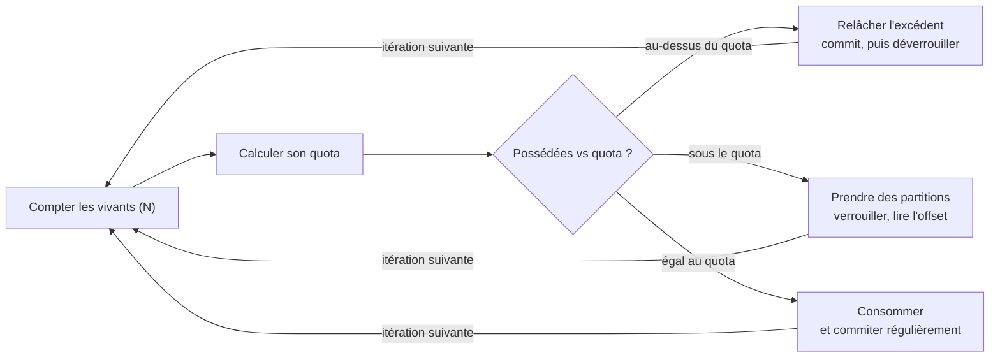

# Mojay — note de conception

Version versionnée avec le code de la [note de conception en ligne](https://claude.ai/artifact/674k8FuSABpT9t2fr7fA1w).
Dernière mise à jour : 20 novembre 2026.

## Contexte et objectifs

Mojay est une bibliothèque Rust qui offre topics, partitions, offsets et consumer groups dans un simple dossier local, sans serveur ni Docker. C'est l'équivalent de SQLite pour Kafka : on ouvre un dossier, on produit, on consomme.

**Objectifs de la V1**

- Embarquable : une crate Rust, puis une ABI C pour des bindings Python, Node, etc.
- Zéro serveur : toute la coordination passe par le système de fichiers (verrous `flock`).
- Multi-processus : plusieurs processus d'une même machine partagent le même dossier.
- Durabilité configurable et récupération automatique après crash.

**Non-objectifs de la V1**

- Cluster, réplication, accès depuis plusieurs machines.
- Compatibilité avec le protocole réseau Kafka (possible plus tard, en couche au-dessus de la lib).
- Transactions et exactly-once.
- Compaction par clé, compression.
- Systèmes de fichiers réseau (NFS, SMB), et Windows : la V1 cible macOS et Linux.

## Concepts

Mojay reprend le vocabulaire de Kafka sans concept nouveau. Un consumer seul, un consommateur indépendant sans groupe, est l'unique membre d'un groupe qui porte son nom. Offsets et répartition passent ainsi par un seul chemin de code.

| Concept | Définition dans Mojay |
| --- | --- |
| Dossier de données | L'équivalent du fichier SQLite : tout l'état vit dedans, rien ailleurs. |
| Topic | Un nom et un nombre de partitions fixé à la création. Un seul writer à la fois. |
| Partition | Un log append-only ordonné. Unité d'ordre et unité de répartition dans un groupe. |
| Offset | Un `u64` par partition, qui commence à 0 et ne fait que croître. |
| Message | Clé optionnelle, valeur, headers, timestamp en millisecondes. |
| Consumer | Un processus qui lit un ou plusieurs topics. Il appartient toujours à un groupe, éventuellement seul dedans. |
| Consumer group | Des consumers qui se partagent les partitions, avec des offsets communs. Identifié par son nom. |
| Limite de lecture | Par partition, le premier offset pas encore lisible (`read_limit`). Les lecteurs ne lisent jamais au-delà. C'est l'équivalent du « high watermark » de Kafka. |

## Arborescence sur disque

Un topic est un dossier avec un sous-dossier par partition. Chaque consumer group a son propre espace, y compris le groupe d'un consumer seul, ce qui évite que deux processus écrivent le même fichier.

```
data/
  mojay.toml                       # version du format, options globales
  topics/<topic>/
    meta.toml                      # nombre de partitions, rétention, politique fsync
    writer.lock                    # flock exclusif = le writer du topic
    read_limits                    # limites de lecture, partagées en mmap
    p0/
      00000000000000000000.log     # segment, nommé par son premier offset
      00000000000000000000.idx     # index clairsemé offset -> position
    p1/ ...
  groups/<group>/                  # un consumer seul = un groupe à son nom
    members/<member_id>.lock       # verrouillé tant que le membre vit
    partitions/<topic>-<p>.lock    # verrouillé = partition possédée
    offsets/<topic>-<p>            # offset commité du groupe
```

Toutes les mises à jour de petits fichiers (`meta.toml`, offsets) sont atomiques : écriture d'un fichier temporaire, `fsync`, puis `rename`.

## Format du log

Chaque partition est une suite de segments append-only. Chaque enregistrement porte sa longueur et son CRC, ce qui permet de détecter une fin écrite à moitié après un crash.

**Segment** (`.log`) : un en-tête de 16 octets (magic `MOJAY\0`, version du format en `u16`, réservé), puis les enregistrements. On passe au segment suivant au-delà d'une taille maximale configurable.

**Enregistrement** (little-endian) :

| Champ | Type | Rôle |
| --- | --- | --- |
| `length` | `u32` | Taille de tout ce qui suit |
| `crc` | `u32` | CRC32C de tout ce qui suit |
| `offset` | `u64` | Offset absolu dans la partition |
| `timestamp` | `i64` | Millisecondes depuis l'epoch, fourni par le producteur |
| `attributes` | `u8` | Réservé (compression, flags futurs) |
| `key_len` + `key` | `i32` + octets | -1 = pas de clé |
| `value_len` + `value` | `i32` + octets | -1 = valeur nulle (tombstone) |
| `headers_count` | `u16` | Puis pour chaque header : `u16` + clé, `u32` + valeur |

**Index** (`.idx`) : des paires `(offset relatif u32, position u32)`, une tous les 4 Kio écrits. Pour lire un offset, on fait une recherche binaire dans l'index, puis un court parcours du segment. L'index se reconstruit entièrement depuis le `.log` : il n'a pas besoin d'être durable.

**Limites de lecture** (`read_limits`) : un fichier partagé en `mmap`, avec un `u64` aligné par partition. Le writer les publie avec une écriture atomique *Release* après chaque ajout. Les lecteurs les lisent avec une lecture atomique *Acquire*, sans appel système.

## Writer unique par topic

Un seul processus écrit dans un topic à la fois : celui qui tient le verrou `flock` exclusif sur `writer.lock`. Si ce processus crashe, l'OS libère le verrou, et le writer suivant répare la fin du log avant d'écrire.

1. **Prise du verrou** : `flock(LOCK_EX | LOCK_NB)`. En cas d'échec, on renvoie `Error::Busy`, ou on attend si l'appelant a fourni un délai.
2. **Récupération** : pour chaque partition, on relit le dernier segment depuis la dernière entrée d'index et on valide longueur et CRC. On tronque tout ce qui suit le dernier enregistrement valide, puis on recalcule l'index et la limite de lecture.
3. **Choix de la partition** : imposée par l'appelant, sinon hash de la clé (murmur2, comme Kafka), sinon round-robin quand il n'y a pas de clé.
4. **Ajout** : on écrit l'enregistrement, on met à jour l'index si besoin, on applique la politique de `fsync`, puis on publie la nouvelle limite de lecture.
5. **Rotation et rétention** : on ouvre un nouveau segment au-delà de la taille maximale. Le writer supprime les segments scellés les plus anciens qui dépassent la rétention ; le premier offset disponible est simplement la base du premier segment restant.

**Rétention**, configurée par topic (`retention_bytes` et `retention_ms` dans `meta.toml`) :

- **Par défaut, aucune** : on garde tout. Supprimer des données sans l'avoir demandé serait une mauvaise surprise.
- **Taille** : la partition, segment actif compris, ne dépasse pas `max_bytes`, vérifié à chaque ajout à partir des tailles connues en mémoire. Elle ne la dépasse que si le segment actif seul la dépasse.
- **Âge** : un segment scellé est supprimé quand sa dernière écriture date de plus de `max_age`. On utilise la date du fichier, pas les timestamps des messages, fournis par les producteurs et donc peu fiables. Vérifié à l'ouverture, à chaque nouveau segment, au plus une fois par seconde pendant les envois, et à la demande (`Producer::enforce_retention`).
- **Jamais de trou** : on ne supprime que des segments scellés entiers, du plus ancien au plus récent, jamais le segment actif.
- **Ordre de suppression** : le `.log` puis l'index. Un crash entre les deux laisse un index orphelin, nettoyé à l'ouverture suivante.
- **Lecteurs** : un lecteur remarque une suppression en moins de 500 ms et relâche le fichier. Sans cela, son descripteur ouvert garderait l'espace disque occupé indéfiniment.
- **Limite** : la rétention n'est appliquée que lorsqu'un producteur est ouvert sur le topic.

| Politique `fsync` | Quand | Survit à un crash du processus | Survit à une coupure de courant |
| --- | --- | --- | --- |
| `Always` | Avant chaque publication de la limite de lecture (par défaut) | Oui | Oui |
| `Interval(ms)` | Périodiquement, par un thread dédié | Oui | Sauf la dernière fenêtre |
| `Never` | Laissé à l'OS | Oui | Non garanti |

Un crash du processus ne perd que ce qui n'a pas encore été passé à `write`, car le cache de pages de l'OS survit. Seul `fsync` protège d'une coupure de courant ou d'un crash du noyau.

## Lecture des messages

Un topic accepte autant de consumers que voulu, sans aucun verrou en lecture. Les offsets sont toujours ceux d'un groupe, même pour un consumer seul.

- **Lecture** : les segments sont lus par `pread`, par gros blocs. Le `mmap` ne sert qu'au fichier `read_limits`. Aucune lecture ne dépasse la limite de lecture. Le log est append-only, donc lire pendant une écriture est sûr.
- **Écriture en cours** : juste après la limite de lecture, le writer peut être en train d'écrire. Un enregistrement illisible à cet endroit n'est donc pas une erreur ; avant la limite, c'en est une. Le lecteur ne répare jamais rien, et découvre seul les nouveaux segments.
- **Consumer seul** : un groupe à un membre, qui reçoit donc toutes les partitions. Si un second processus ouvre le même nom, il rejoint le groupe et les membres vivants se répartissent les partitions (voir ci-dessous).
- **Offsets** : `groups/<group>/offsets/<topic>-<p>` fait 12 octets : l'offset (`u64`) puis son CRC32C (`u32`). Il n'est écrit que par le détenteur du verrou de la partition. Le commit est manuel (`commit()`), ou automatique : au plus tôt à l'intervalle choisi, au début de chaque `poll` et à la fermeture. Les messages rendus par un `poll` sont alors considérés comme traités au `poll` suivant.
- **Point de départ** : sans offset commité, on part du début (`Earliest`) ou de la fin (`Latest`). Un offset commité au-delà de la limite de lecture (messages perdus avec `fsync` `Never` ou `Interval`) est ramené à la limite, pour ne sauter aucun nouveau message.
- **Offset disparu** : si la rétention a supprimé l'offset demandé, la même politique s'applique : avec `Earliest`, le consumer repart du nouveau premier offset, sans erreur.
- **Attente de nouveaux messages** : en V1, un polling adaptatif de la limite de lecture en mémoire partagée, de 1 ms à 50 ms selon l'activité. Le coût est négligeable, car c'est une simple lecture mémoire.

`inotify` et `kqueue` ne signalent pas les écritures faites via `mmap`. Une notification événementielle demandera donc un canal séparé, à étudier après la V1.

## Consumer groups sans serveur

Un membre possède une partition tant qu'il tient le `flock` sur `partitions/<topic>-<p>.lock`. Le système de fichiers joue le rôle du coordinateur de Kafka : pas de serveur, pas de heartbeat, et un membre qui crashe perd ses verrous instantanément.

Chaque membre exécute cette boucle de son côté, toutes les 200 ms, et les vues des membres convergent en quelques itérations :



1. **Compter les vivants** : on tente un `flock` non bloquant sur chaque fichier de `members/`. S'il réussit, le membre est mort et on supprime son fichier. On obtient N membres vivants, triés par identifiant. L'identifiant commence par l'instant d'inscription : le rang 0 est le membre le plus ancien.
2. **Calculer son quota** : avec P partitions et un rang r parmi les vivants, quota = ⌊P / N⌋, plus 1 si r < P mod N. La somme des quotas vaut exactement P.
3. **Au-dessus du quota** : on relâche le verrou des partitions en trop. Avec le commit automatique, on commite d'abord leur position (voir « Passage de relais »).
4. **Sous le quota** : on tente un `flock` non bloquant sur les partitions libres, en partant d'un index dérivé de son rang pour limiter les collisions. Pour chaque partition obtenue, on lit l'offset commité du groupe.

**Passage de relais** : on lit toujours l'offset commité *après* avoir pris le verrou.

- **Commit automatique** : on commite la position avant de relâcher. Un rebalance normal ne produit donc aucun doublon ; seul un crash rejoue les messages depuis le dernier commit.
- **Commit manuel** : on relâche *sans* commiter. Commiter à la place de l'application pourrait marquer comme traités des messages qu'elle garde encore en mémoire, et donc les perdre. Le nouveau propriétaire relit depuis le dernier commit : doublons possibles, aucune perte. Pour les éviter, l'application commite avant chaque `poll`.

**Événements** : `take_rebalance_events()` rend les partitions reçues (`Assigned`) et cédées (`Revoked`) depuis le dernier appel. C'est plus simple à utiliser en Rust que des callbacks, et suffit à l'application pour savoir ce qu'elle a perdu.

**Limites** : un membre qui n'appelle plus `poll` garde ses partitions tant qu'il vit (pas de délai d'expiration). Les membres d'un groupe doivent s'abonner aux mêmes topics : sinon la répartition reste sûre (jamais deux lecteurs par partition) mais n'est plus équilibrée.

**Inscription sans course** : un nouveau membre crée son fichier sous un nom temporaire, le verrouille, puis le renomme dans `members/`. Le verrou suit l'inode, donc personne ne voit jamais ce fichier sans verrou et ne le prend pour celui d'un membre mort.

**Offsets du groupe** : `offsets/<topic>-<p>` n'est écrit que par le détenteur du verrou de la partition, par écriture atomique : fichier temporaire, puis `rename`.

## API publique Rust (esquisse)

L'API est synchrone en V1, avec trois points d'entrée : `Db`, `Producer` et `Consumer`. Une variante async pourra venir derrière une feature Cargo.

```rust
use mojay::{ConsumerConfig, Db, Message, StartFrom, TopicConfig};
use std::time::Duration;

let db = Db::open("./data")?;
db.create_topic("orders", TopicConfig { partitions: 4, ..Default::default() })?;

// Producteur : prend le verrou writer du topic, Err(Busy) si déjà pris
let mut producer = db.producer("orders")?;
let (partition, offset) = producer.send(&Message::new(b"cmd-42", b"{...}"))?;
producer.flush()?;

// Consumer : rejoint le groupe "billing", seul dedans s'il est le seul processus
let config = ConsumerConfig { start_from: StartFrom::Earliest, ..Default::default() };
let mut consumer = db.consumer("billing", &["orders"], config)?;
loop {
    for rec in consumer.poll(Duration::from_millis(500))? {
        println!("{} / {} : {:?}", rec.partition, rec.offset, rec.value);
    }
    consumer.commit()?;
}
```

- **Lecture brute** (disponible depuis l'étape 2) : `db.reader(topic)` renvoie un `TopicReader`, qui lit une partition à partir d'un offset, sans verrou et sans dépasser la limite de lecture. Les consumers de l'étape 3 s'appuient dessus.
- **Administration** : `list_topics`, `describe_topic` (configuration, et pour chaque partition son premier offset, sa limite de lecture et ses segments), `committed_offsets` (offsets commités par chaque groupe). `delete_topic` reste à faire.
- **Inspection** : `mojay::inspect::dump_segment` lit un segment brut, sans rien réparer, et rapporte une éventuelle fin illisible au lieu d'échouer.
- **Rebalance** : `consumer.take_rebalance_events()` rend les partitions reçues et cédées ; `consumer.assignment()` donne les partitions possédées.
- **Erreurs** : `Busy`, `TopicExists`, `UnknownTopic`, `OffsetOutOfRange`, `Corrupt`, `Io`.

## Garanties et limites

Mojay garantit l'ordre par partition et une livraison at-least-once, sur une seule machine et un système de fichiers local.

**Garanties**

- Ordre strict à l'intérieur d'une partition, et deux messages de même clé vont toujours dans la même partition.
- Livraison at-least-once pour tous les consumers, seuls ou en groupe : un crash entre traitement et commit rejoue les messages concernés.
- Aucun message n'est visible avant d'être entièrement écrit, grâce à la limite de lecture.
- Durabilité selon la politique `fsync` choisie.

**Limites assumées**

- Système de fichiers local uniquement : `flock` n'est pas fiable sur NFS, SMB ou un dossier synchronisé dans le cloud. SQLite a la même restriction.
- Une seule machine.
- Un writer par topic, donc le débit d'écriture d'un topic est celui d'un seul processus.
- Nombre de partitions fixe en V1 : en ajouter changerait la partition associée à chaque clé.
- La latence d'un rebalance dépend de la période de la boucle (200 ms par défaut).

**Pièges connus**

- Utiliser `flock`, jamais les verrous POSIX `fcntl` : ceux-ci sont relâchés dès que le processus ferme *n'importe quel* descripteur sur le fichier.
- Un verrou `flock` est partagé avec tout processus enfant créé par `fork`, jusqu'à son `exec`. Fermer le fichier ne suffit donc pas à le libérer à coup sûr : on appelle `flock(LOCK_UN)` explicitement. Ce cas a été trouvé par un test instable, une fois sur huit.
- Sous Windows (hors V1), on ne peut pas supprimer un segment encore ouvert par un lecteur : la rétention devra y être différée.
- Les timestamps viennent de l'horloge du producteur, sans garantie de monotonie.

## Feuille de route

Le MVP se construit de bas en haut. Chaque étape est testable seule, en commençant par le log d'une partition.

1. ✅ Log d'une partition : format, segments, index, récupération. Tests de crash par troncature à chaque octet de la fin du log.
2. ✅ Topics, writer verrouillé et limites de lecture partagées. Tests multi-processus : second writer refusé, writer tué en pleine écriture, lecteur qui suit un writer d'un autre processus.
3. ✅ Consumer seul : lecture et offsets commités, commit manuel ou automatique, relais vers un second membre à l'arrêt ou au crash du premier. Tests multi-processus : membre tué, reprise exacte au dernier commit.
4. ✅ Consumer groups à plusieurs membres : quotas, arrivées et départs, détection des membres morts, événements de rebalance. Tests multi-processus : deux processus se partagent le travail sans doublon, un membre tué est remplacé.
5. ✅ Rétention par taille et par durée : suppression des plus vieux segments scellés, lecteurs qui relâchent les fichiers supprimés, consumers en retard qui repartent du nouveau début.
6. ✅ CLI `mojay`, une crate séparée du workspace pour ne pas imposer `clap` à la bibliothèque :

    | Commande | Rôle |
    | --- | --- |
    | `create-topic` | Crée un topic, avec des unités lisibles (`--segment-size 64Mio`, `--fsync 100ms`, `--retention-time 7d`) |
    | `topics` | Liste les topics |
    | `describe` | Configuration, partitions (début, limite, segments, taille) et retard de chaque groupe |
    | `produce` | Envoie un message, ou une ligne de l'entrée standard par message, avec clé, partition et headers |
    | `tail` | Affiche les messages sans rien commiter : depuis le début, `-n` derniers, `--offset`, `-f` pour suivre |
    | `dump` | Affiche un segment en texte (positions, offsets, tailles, contenu, index) et signale une fin illisible sans rien réparer |

    Le dossier vient de `--data` ou de `MOJAY_DATA`. Seule `create-topic` crée un dossier de données : une faute de frappe ne doit pas en créer un vide ailleurs.
7. ✅ Binding Node.js (`bindings/node`), avec napi-rs plutôt qu'une ABI C : appels directs à la bibliothèque, mémoire gérée par napi-rs, définitions TypeScript générées. Chaque producteur et chaque consumer a son propre thread et une file de tâches : `send`, `poll` et `commit` renvoient des Promises, s'exécutent dans l'ordre des appels, et ne bloquent ni la boucle d'événements ni le pool de threads de Node. Les erreurs sont des `Error` avec un `code` stable (`MOJAY_BUSY`…).
8. Plus tard, selon les besoins : une ABI C (pour Go, C++…) et un binding Python (PyO3).

Après la V1 : index temporel (positionnement par timestamp), compression, compaction par clé, notification événementielle, couche protocole Kafka.


## Décisions

| Sujet | Décision |
| --- | --- |
| Politique `fsync` par défaut | `Always` |
| Taille de segment par défaut | 64 Mio |
| Hash de partitionnement | murmur2, compatible Kafka |
| Lecture des segments | `pread` ; `mmap` seulement pour `read_limits` |
| Écriture | Un writer par topic |
| Windows | Hors périmètre de la V1 |
| Voir les messages en texte | `mojay dump` (étape 6) plutôt qu'un second format de stockage : un seul format à fiabiliser |
| Commit par défaut | Manuel ; automatique sur demande (`auto_commit`) |
| Rétention par défaut | Aucune : on garde tout |
| Âge d'un segment | Date de sa dernière écriture sur le disque, pas les timestamps des producteurs |
| Commit d'une partition cédée | Seulement en commit automatique ; en manuel, relecture depuis le dernier commit plutôt qu'un risque de perte |
| Notification des rebalances | `take_rebalance_events()` plutôt que des callbacks |
| Premier binding | Node.js avec napi-rs, avant l'ABI C et Python |
| Appels asynchrones en Node | Un thread et une file par producteur ou consumer : ordre des appels garanti, pool de threads de Node jamais occupé |
