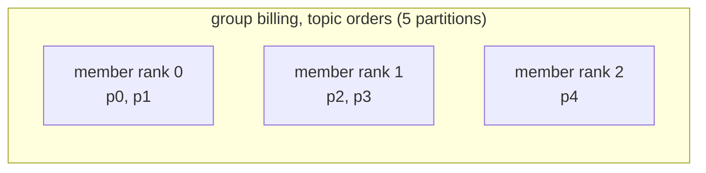

A **consumer** reads one or more topics as a member of a **consumer group**.
The members of a group share the partitions of the topics they read: each
partition is read by exactly one member at a time, and the group keeps one
committed position per partition.

## A lone consumer is a group of one

Every consumer belongs to a group. There is no separate "standalone consumer"
mode: a consumer that is alone simply runs in a group of one, named by you, and
owns every partition.

```rust
use std::time::Duration;
use mojay::ConsumerConfig;

let mut consumer = db.consumer("billing", &["orders"], ConsumerConfig::default())?;
```

Start the same code in a second process, with the same group name, and the two
processes share the partitions. Use another group name, and the new consumer
reads everything again, independently, with its own positions.

A consumer can subscribe to several topics: `db.consumer("audit", &["orders", "payments"], config)`.
The members of a group should all subscribe to the same topics. If they do not,
the assignment stays safe (never two readers on one partition) but is no longer
balanced.

## Members and quotas

The members of a group coordinate through files in the data folder, without a
coordinator process:

- A member is **alive** as long as it holds a lock on its own file in the
  group's folder. When its process exits or crashes, the operating system
  releases the lock immediately: there is no heartbeat and no session timeout.
- Members are ranked by the time they joined: rank 0 is the oldest.
- A member **owns** a partition while it holds that partition's lock.

With P partitions and N live members, the member of rank r owns
⌊P / N⌋ partitions, plus one if r is less than P mod N. The quotas add up to exactly P, and
the oldest members take the extra ones.



With 5 partitions and 3 members, the quotas are 2, 2 and 1. The quotas are
fixed by the ranks; which partitions each member ends up with depends on which
ones were free when it looked, as in this example. With more members
than partitions, the youngest members own nothing and wait: they take over as
soon as an older member leaves.

## Rebalancing

Each member checks the group at most every 200 ms, during `poll`:

1. it counts the live members, and computes its quota;
2. above its quota, it releases partitions;
3. below its quota, it tries to take free partitions, and reads the group's
   committed offset for each one it gets.

The members' views converge within a few rounds, so a rebalance usually
completes in well under a second. This happens when:

- **a member joins**: the others give up partitions until the newcomer has its
  share;
- **a member leaves** (drop in Rust, `close()` in Node.js): its partitions are
  free, and the others take them;
- **a member crashes**: the operating system releases its locks, and the others
  take its partitions as if it had left.

What happens to the position of a partition that changes hands depends on the
commit mode: see [Offsets and commits](./offsets-and-commits.md#handing-over-a-partition).

:::warning A member that stops polling keeps its partitions
Rebalancing runs inside `poll`. A member that is alive but no longer calls
`poll` keeps its partitions, and nobody else reads them, for as long as its
process lives. There is no timeout. Close consumers you no longer use.
:::

The mechanism is detailed in [Consumer groups without a server](../how-it-works/consumer-groups-without-a-server.md).

## Rebalance events

To know which partitions the consumer received or gave up, ask after each
`poll`:

```rust
use mojay::RebalanceEvent;

let records = consumer.poll(Duration::from_millis(500))?;
for event in consumer.take_rebalance_events() {
    match event {
        RebalanceEvent::Assigned { topic, partition } => println!("+ {topic}/{partition}"),
        RebalanceEvent::Revoked { topic, partition } => println!("- {topic}/{partition}"),
    }
}
```

`take_rebalance_events()` returns the events since the last call, in order.
In Node.js, `await consumer.rebalanceEvents()` returns
`[{ kind: 'assigned' | 'revoked', topic, partition }]`.

To see the current assignment, use `consumer.assignment()`: a sorted list of
`(topic, partition)` in Rust, `[{ topic, partition }]` in Node.js.
`consumer.position(topic, partition)` (Rust only) gives the next offset the
consumer will return for a partition it owns.

## Polling

```rust
loop {
    for record in consumer.poll(Duration::from_millis(500))? {
        handle(&record)?;
    }
    consumer.commit()?;
}
```

`poll(timeout)`:

- returns as soon as there are messages, without waiting for the timeout;
- returns an empty list if nothing arrived before the timeout;
- returns at most about `max_poll_bytes` of messages (1 MiB by default), but
  always at least one message if one is available;
- serves the owned partitions in turn from one call to the next, so that a busy
  partition does not starve the others;
- never returns a message beyond the [read limit](./offsets-and-commits.md#the-read-limit),
  so every message it returns is complete (and on disk, with the `Always`
  policy).

Each `ConsumerRecord` has `topic`, `partition`, `offset`, `timestamp`, `key`,
`value` and `headers`. Within one partition, records come in offset order.

While waiting, a consumer checks for new messages by reading a value in shared
memory, every 1 ms at first, then backing off to every 50 ms while nothing
arrives. This costs almost nothing, and a new message is usually seen within a
few milliseconds.

`ConsumerConfig` fields:

| Field | Default | Meaning |
| --- | --- | --- |
| `start_from` | `StartFrom::Earliest` | Where to start a partition when the group has no usable committed offset: `Earliest` or `Latest`. |
| `auto_commit` | `None` (manual) | `Some(interval)` commits automatically. See [Offsets and commits](./offsets-and-commits.md#manual-or-automatic-commit). |
| `max_poll_bytes` | 1 MiB | Approximate maximum size of the messages returned by one `poll`. |

`db.consumer` fails with `Error::UnknownTopic` if a topic does not exist, and
with `Error::InvalidConfig` if the list of topics is empty or has a duplicate.

## Reading without a group: `TopicReader`

Sometimes you want to read a topic without joining a group and without
committing anything: to replay history, build a view, or display messages like
`mojay tail` does. Use a `TopicReader`:

```rust
let mut reader = db.reader("orders")?;
for partition in 0..reader.partitions() {
    let mut offset = reader.start_offset(partition)?;
    let limit = reader.read_limit(partition)?;
    while offset < limit {
        let records = reader.read(partition, offset, 1024 * 1024)?;
        for record in &records {
            println!("{partition}/{}: {:?}", record.offset, record.value);
        }
        offset = records.last().map_or(limit, |r| r.offset + 1);
    }
}
```

| Method | Meaning |
| --- | --- |
| `partitions()` | The number of partitions. |
| `start_offset(partition)` | The first available offset (it moves when retention deletes segments). |
| `read_limit(partition)` | The first offset not yet readable. |
| `read(partition, offset, max_bytes)` | The messages from `offset`, up to about `max_bytes` and never beyond the read limit. At least one message if one is readable. Reading at the read limit returns an empty list. |

A reader takes no lock and modifies nothing: you can open as many as you want,
in any process, while producers write. It has no position of its own and
commits nothing; you track offsets yourself. `read` returns
`Error::OffsetOutOfRange` for an offset before the start of the partition (for
example deleted by retention) or beyond its read limit. The error carries the
valid range, so you can resume from `start`.

The Node.js binding does not expose `TopicReader` yet.
