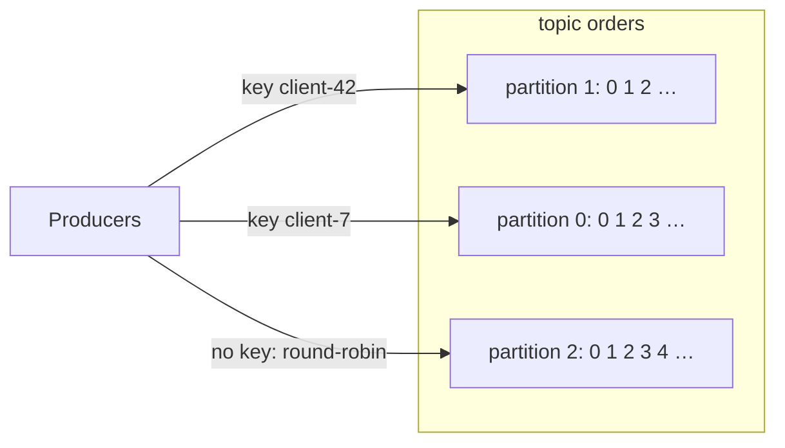

Mojay uses Kafka's vocabulary, with no new concept. If you know Kafka, this page
mostly tells you which parts carry over.

## Topics

A **topic** is a named stream of messages, for example `orders` or
`audit-events`. Producers append messages to it; consumers read them. Reading
a message does not remove it: it stays in the topic until
[retention](./retention.md) deletes it, and any number of consumer groups can
read it independently.

A topic is a folder inside the data folder, created once with its
configuration:

```rust
use mojay::{Db, TopicConfig};

let db = Db::open("./data")?;
db.create_topic("orders", TopicConfig { partitions: 4, ..Default::default() })?;
```

Creation is atomic: the topic appears complete, or not at all. Other ways to
look at topics:

| Rust | Node.js | CLI | Purpose |
| --- | --- | --- | --- |
| `db.list_topics()` | `db.listTopics()` | `mojay topics` | Topic names, sorted. |
| `db.describe_topic(name)` | `db.describeTopic(name)` | `mojay describe <name>` | Configuration, and for each partition its first offset, read limit and segments. |

There is no way to delete a topic or change its configuration in version 1.

## Partitions

Each topic has a fixed number of **partitions**. A partition is an
append-only, ordered log: each message in it gets an **offset**, a `u64` that
starts at 0 and grows by one for each message.

Partitions are what you scale with:

- **Ordering** is guaranteed inside a partition, not across partitions.
- **Consumer groups** share work by partition: each partition is read by one
  member of the group at a time. A group cannot have more busy members than the
  topic has partitions.



The number of partitions cannot change after creation: adding partitions would
change the partition that each key maps to, and break per-key ordering. Pick a
number with room to grow, such as the maximum number of consumers you expect to
run in parallel in one group.

## How a message's partition is chosen

When you produce a message, its partition is decided in this order:

1. **Explicit**: `send_to(partition, …)` or `send_batch_to(partition, …)` in Rust,
   the `partition` field of the message in Node.js, `--partition` in the CLI.
2. **By key**: if the message has a key, its partition is the murmur2 hash of
   the key modulo the number of partitions. This is the same function as Kafka's
   default partitioner, so a key lands in the same partition number with Mojay
   and with Kafka, for the same partition count.
3. **Round-robin**: a message without a key goes to the next partition in turn.
   Each producer keeps its own round-robin position, starting at partition 0.

If you mix explicit partitions and keys, a key is no longer guaranteed to stay
in one partition: choose one approach per topic.

## Ordering guarantees

- Inside a partition, offsets are strictly increasing, and consumers read the
  messages in offset order.
- Two messages with the same key (and no explicit partition) always go to the
  same partition, so they are read in the order they were written.
- The messages of one producer keep the order of its calls.
- When several producers write to the same partition, their messages interleave
  in time, but each message still gets exactly one offset. See
  [Producers](./producers.md#several-producers).
- There is no order across partitions.

## Messages

A message has:

| Field | Type (Rust) | Notes |
| --- | --- | --- |
| `key` | `Option<Vec<u8>>` | Optional. Chooses the partition. |
| `value` | `Option<Vec<u8>>` | Optional. A message without a value is a tombstone (Mojay does not compact topics, so it is stored like any other message). |
| `headers` | `Vec<Header>` | Each header has a text `key` and a binary `value`, as in Kafka. |
| `timestamp` | `Option<i64>` | Milliseconds since the epoch. Defaults to the producer's clock when the message is appended. |

Keys and values are bytes: Mojay does not interpret them. Encode them as you
like (JSON, Protocol Buffers, plain text…).

In Rust, `Message::new(key, value)` builds a keyed message,
`Message::with_value(value)` a message without key, and `.header(key, value)` and
`.timestamp(millis)` add the rest. An encoded message, including its headers,
cannot exceed 16 MiB (`mojay::MAX_RECORD_SIZE`).

Timestamps come from the producer's clock: they are not guaranteed to increase
with offsets.

## Topic configuration

`TopicConfig` is fixed at creation. Its `log` field is a `LogConfig`:

```rust
use std::time::Duration;
use mojay::{FsyncPolicy, LogConfig, Retention, TopicConfig};

let config = TopicConfig {
    partitions: 4,
    log: LogConfig {
        segment_max_bytes: 16 * 1024 * 1024,
        fsync: FsyncPolicy::Interval(Duration::from_millis(100)),
        retention: Retention {
            max_bytes: Some(10 * 1024 * 1024 * 1024),
            max_age: Some(Duration::from_secs(7 * 24 * 3600)),
        },
        ..Default::default()
    },
};
db.create_topic("events", config)?;
```

| Rust field | Node.js option | CLI option | Default | Meaning |
| --- | --- | --- | --- | --- |
| `partitions` | `partitions` | `--partitions` | 1 | Number of partitions, from 1 to 10,000. |
| `log.segment_max_bytes` | `segmentBytes` | `--segment-size` | 64 MiB | Size beyond which a partition moves on to a new segment file. |
| `log.index_interval_bytes` | — | — | 4096 | Bytes written between two entries of a segment's index. You rarely need to change it. |
| `log.fsync` | `fsync` | `--fsync` | `Always` | When data is forced to disk. See [Durability](./durability.md). |
| `log.retention.max_bytes` | `retentionBytes` | `--retention-size` | none | Maximum size of each partition. See [Retention](./retention.md). |
| `log.retention.max_age` | `retentionMs` | `--retention-time` | none | Maximum age of a segment. See [Retention](./retention.md). |

An invalid configuration (0 partitions, a segment size of 16 bytes or less or
close to 4 GiB, an `Interval` of zero…) is rejected with `Error::InvalidConfig`.

## Names

Topic names and group names follow the same rules, so that they are usable as
folder names everywhere:

- between 1 and 249 characters;
- only ASCII letters, digits, `.`, `_` and `-`;
- not starting with `.`.

Any other name is rejected with `Error::InvalidName` (`MOJAY_INVALID_NAME` in
Node.js).

## Related pages

- [Producers](./producers.md)
- [On-disk layout](../how-it-works/on-disk-layout.md): what a topic looks like in the data folder
