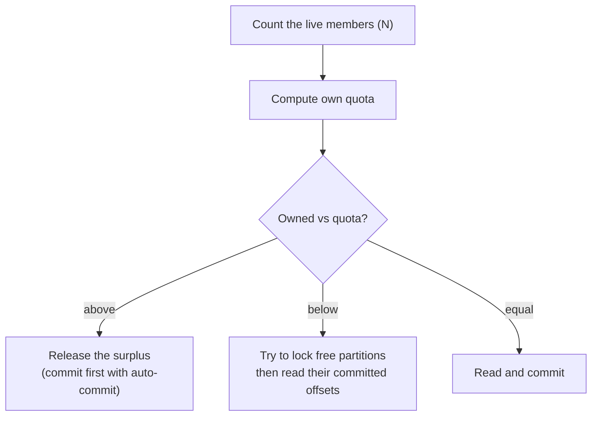

In Kafka, a group coordinator running in the broker tracks members through heartbeats and hands out partitions. Mojay has no broker, so the file system plays that role: **a member is alive as long as it holds a lock on its member file, and owns a partition as long as it holds a lock on that partition's file.** A process that dies loses its locks instantly, so there are no heartbeats and no session timeouts.

```text
groups/<group>/
  members/<member_id>.lock        # flock held = live member
  partitions/<topic>-<p>.lock     # flock held = partition owned by a member
  offsets/<topic>-<p>             # the group's committed offset
```

## A lone consumer is a group of one

Every consumer belongs to a group. A consumer on its own is simply the only member of the group named after it: `db.consumer("billing", &["orders"], config)` joins the group `billing`, and as the only member it gets every partition. If a second process opens a consumer with the same group name, it joins the group and the two share the partitions. Offsets and partition assignment go through a single code path, whether there is one member or ten.

## Joining a group

A member's identifier starts with its registration time in nanoseconds, followed by the process id and a counter: sorting identifiers sorts members from oldest to newest.

To register without a race, a new member:

1. creates its file under a temporary name in the group folder (`.joining-<id>`);
2. locks it with `flock`;
3. renames it into `members/<id>.lock`, and flushes the folder.

The lock follows the file, not its name, so no other member can ever see this file unlocked in `members/` and mistake it for the leftover of a dead member.

When a member leaves cleanly, it deletes its file first, then releases the lock. When it crashes, the operating system releases the lock and the file stays behind, unlocked.

## Sharing the partitions

Each member runs the same loop on its own: when it opens, and then during `poll`, at most every 200 ms. The members' views converge within a few iterations.



1. **Count the live members.** For each file in `members/`, try a non-blocking `flock`. If the lock is held, that member is alive. If the lock is free, the member is dead: delete its file. Sort the live members by identifier: rank 0 is the oldest.
2. **Compute the quota.** With P partitions, N live members, and this member's rank r: `quota = ⌊P / N⌋`, plus 1 if `r < P mod N`. The quotas add up to exactly P, and differ by at most one.
3. **Above the quota**, release the surplus: unlock the last owned partitions. With automatic commit, commit their position first (see below).
4. **Below the quota**, try a non-blocking `flock` on partitions, starting from a position derived from the rank (r × P / N), so that members looking at the same time try different partitions first. For each partition obtained, read the group's committed offset, after taking the lock.

The partitions of all subscribed topics are numbered the same way on every member: topics sorted by name, then partitions in order. For example, with 4 partitions and 3 members, the quotas are 2, 1 and 1, the oldest member taking the extra one. With more members than partitions, the newest members get none and wait as standbys.

### Noticing joins, departures and crashes

There is no notification: each member finds out at its next rebalance, by counting the lock files.

- **A member joins.** The others count one more member, their quotas drop, and they release partitions. The new member takes them as they become free.
- **A member leaves.** Its file is gone and its partition locks are released. The others count one fewer member, their quotas rise, and they lock the freed partitions.
- **A member crashes.** The operating system releases all its locks at once. The next member to count finds its file unlocked, deletes it, and the freed partitions are picked up exactly as after a clean departure.

The reaction time is the loop period: about 200 ms, plus the time for each member to reach its next `poll`.

### Rebalance events

`take_rebalance_events()` in Rust, or `rebalanceEvents()` in Node.js, returns the partitions received (`Assigned`) and given up (`Revoked`) since the last call, in order. It is simpler to use than callbacks, and it tells the application what it no longer owns. `assignment()` gives the partitions owned right now.

## Handing a partition over

The new owner always reads the committed offset **after** taking the partition's lock. The previous owner, if it committed, did so before releasing the lock, so the offset read is final.

- **With automatic commit**, the position is committed before the partition is released. A normal rebalance produces no duplicates; only a crash replays messages since the last commit.
- **With manual commit**, the partition is released *without* committing. Committing on the application's behalf could mark as processed messages it still holds in memory, and lose them. The new owner resumes from the last commit: duplicates are possible, losses are not. To avoid the duplicates, commit before each `poll`.

## Committed offsets

`offsets/<topic>-<p>` is 12 bytes: the offset as a `u64`, then its CRC32C as a `u32`, both little-endian. The offset stored is the next one to read.

- **One writer.** Only the member holding the partition's lock writes this file, so two members never race on it.
- **Atomic and durable.** Each commit writes a temporary file, flushes it with `fsync`, renames it over the old one, then flushes the `offsets/` folder. After a crash, the file holds the old offset or the new one, never a mix.
- **Checked on read.** A file of the wrong size or with a bad CRC is reported as `Error::Corrupt` instead of resuming from a wrong position.
- **Only when needed.** A partition whose position has not moved since its last commit is not written again.

With automatic commit, positions are committed at most once per chosen interval, at the start of each `poll`, when a partition is handed over, and when the consumer is closed. Messages returned by a `poll` count as processed at the next `poll`.

### Where a member starts reading

| Situation | Start position |
| --- | --- |
| No committed offset | The oldest message (`Earliest`, the default) or the read limit (`Latest`) |
| Committed offset deleted by retention | Same rule: with `Earliest`, the new first offset, without an error |
| Committed offset beyond the read limit | The read limit: messages were lost with `fsync = never` or `interval`, and no new message is skipped |
| Otherwise | The committed offset |

## Limits

- A member that stops calling `poll` keeps its partitions for as long as its process lives: there is no processing timeout, only crash detection.
- Members of a group should subscribe to the same topics. Otherwise the assignment stays safe (never two readers on a partition) but is no longer balanced.
- Rebalancing takes about 200 ms per iteration.
- Like everything in Mojay, groups work between processes of one machine, on a local file system.

See [Consumers and groups](../concepts/consumers-and-groups.md) and [Offsets and commits](../concepts/offsets-and-commits.md) for how to use them.
