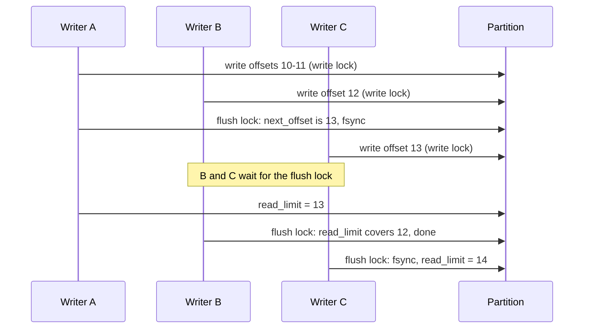

Any number of producers, in any processes, can write to the same topic and the same partition, like several Kafka producers. They take turns, in the manner of SQLite: one `flock` per partition, held for a single batch of messages.

## The steps of a send

A send, or a batch sent with `Producer::send_batch_to` in Rust, goes through these steps for its partition:

1. **Take the write lock.** A blocking `flock(LOCK_EX)` on `p<N>/write.lock`, a file the producer keeps open. The wait lasts at most the time another writer needs to write its batch.
2. **Catch up.** Read the partition's slot in `partitions.state`, published by the previous lock holder, and update this producer's view of the files: new end of the active segment, index entries added by others, segments deleted by retention. Usually a few comparisons and one `fstat`.
3. **Reopen if needed.** If another writer started a new segment, if the active segment's length does not match the published one, if the published first offset lies beyond the active segment (a state the files cannot match, since retention never deletes the active segment), or if `dirty` is still set (a writer died in the middle of a change), the partition is reopened from disk, with the usual [repair of the end](./recovery.md).
4. **Mark dirty.** Set `dirty` before touching any file.
5. **Append.** Validate every message first (an invalid one means none is written), encode the batch, and write it to the active segment with one positional write (one per segment if the batch crosses a rotation); add index entries; roll to a new segment and apply retention if needed. There is no `fsync` here, except for a segment sealed by a rotation.
6. **Publish.** Store the end of the active segment, its base and the first offset, then clear `dirty`, then store `next_offset` last.
7. **Release the write lock**, with an explicit `LOCK_UN`. It was held for a few microseconds.
8. **Make the messages readable.** With `fsync = interval` or `never`, the read limit moves to the end of the batch right away. With `fsync = always`, this is the group commit below. The send returns after this step.

The partition is chosen before step 1: an explicit partition if the caller gave one, otherwise murmur2 on the key (the same hash as Kafka, so a key maps to the same partition as in Kafka with the same partition count), otherwise round-robin for messages without a key.

### Ordering

Offsets in a partition follow the order in which writers took the lock. Each producer's own messages keep their call order. Messages from different producers interleave in time.

## Group commit

With `fsync = always`, a send only returns, and its messages only become readable, once they are on disk. The obvious way to do that is to `fsync` under the write lock. Mojay did that at first, and it made writers queue behind each other's flushes.

The key observation: **an `fsync` makes durable everything written to the file before it, by any writer.** So writers can share flushes. Under a second per-partition lock, `p<N>/flush.lock`, each writer that finished writing does this:

1. Take the flush lock.
2. If `read_limit` already covers the end of its batch, a flush that started after its write has made it durable while it was waiting: nothing to do.
3. Otherwise, read `next_offset`, *then* the base of the active segment, `fsync` that segment, and advance `read_limit` to the `next_offset` it read (with `fetch_max`). That one `fsync` covers the batches of every writer that had written by then.

Writer A's flush covers B's batch as well as its own: B returns without flushing. Meanwhile C could write, because the write lock is no longer held during flushes. C's batch arrived after A read `next_offset`, so C flushes again, and that flush would cover any writer that arrived during A's.

### Why `next_offset` is read before the segment base

A rotation could happen between the two reads. Reading `next_offset` first, with *Acquire* ordering, guarantees that the active segment read afterwards is at least as recent as that offset. Any older segment holding part of the covered range was flushed when it was sealed. If retention deleted the segment in between, there is nothing left to flush.

### Why the read limit waits for the flush

A message becomes readable only once it is on disk. If consumers could read a message before its flush, a power loss could erase it after a consumer had processed it, even committed it. Worse, after recovery the same offset would be given to a different message, and the consumer's committed position would point into a different history. With `fsync = always`, everything below the read limit survives a power loss, so nothing a consumer has seen can disappear.

### Rotation and the index

When a segment is sealed, its `.log` and `.idx` are flushed before the next segment is created, then the new segment and the folder are flushed too. That is why group commit only ever needs to flush the active segment.

A send flushes only the `.log`, not the index. The index is a cache, rebuilt from the log after a crash, so flushing it on every send would only cost time.

### The numbers

Measured on an Apple M5 with an internal SSD, where each flush is an `F_FULLFSYNC` of 3 to 5 ms (see [Benchmarks](../benchmarks.md)):

| `fsync = always`, 100-byte messages | Before: msg/s | Before: p99 | Group commit: msg/s | Group commit: p99 |
| --- | ---: | ---: | ---: | ---: |
| 1 writer on 1 partition | 148 | 14.7 ms | 276 | 6.3 ms |
| 2 writers on 1 partition | 148 | 335.5 ms | 304 | 9.4 ms |
| 4 writers on 1 partition | 168 | 805.3 ms | 580 | 11.5 ms |

Before group commit, four writers were no faster than one, and because `flock` is not fair, an unlucky writer could wait behind many others: p99 latency reached 805 ms. With group commit, four writers reach 580 msg/s, 3.5 times more, with a p99 of 11.5 ms. The write lock is now held for microseconds, so its unfairness no longer shows. Single writers got faster too, because a send no longer flushes the index.

## Other fsync policies

| Policy | When data is flushed | Survives a process crash | Survives a power loss |
| --- | --- | --- | --- |
| `always` (default) | Before the read limit advances, shared between writers | Yes | Yes |
| `interval` | Periodically, by a background thread of each producer | Yes | Except the last interval |
| `never` | Left to the operating system | Yes | Not guaranteed |

A process crash only loses what was not yet passed to `write`: the operating system's page cache survives the process. Only `fsync` protects against a power loss or a kernel crash.

With `interval`, a thread named `mojay-fsync` flushes all partitions of the producer at the chosen interval, and one last time when the producer is dropped. An error in that thread is returned by the producer's next call. See [Durability](../concepts/durability.md) for choosing a policy.

## When a writer crashes

The operating system releases its locks. The next writer to take the write lock sees `dirty` still set, or a file that does not match the published state, and reopens the partition from disk, truncating a partial record at the end. A record written completely before the crash is kept, even though its send never returned: delivery is at least once. If the writer died between its write and its flush, the next flush by any other writer covers its messages too.

Opening a producer also repairs each partition under its write lock, whether or not something looks wrong. That protects against a stale shared state after the machine restarts. With `fsync = always`, it flushes the active segment and then moves the read limit to the end of the log: messages left by a writer that died before its flush become readable, once durable.
